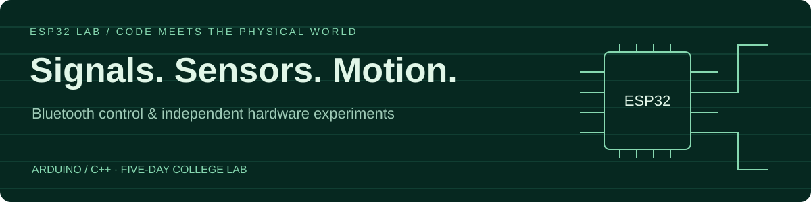

# ESP32 Smart Car Lab
### Bluetooth commands. Sensor readings. Physical movement.

Experiments from a five-day college Skill Lab: controlling a small car over Bluetooth, measuring distance with an ultrasonic sensor, and exploring motor-control variations.

**ESP32 · Arduino / C++ · Bluetooth Serial · I²C LCD**

[Project demo folder](https://drive.google.com/drive/folders/1zajK2-AtPhMCfp8Sq6LwE2uaqMEDQnbu) — access follows the folder's sharing settings.

## Start with the Bluetooth car

[Android_Controlled_Car](Android_Controlled_Car) advertises the Bluetooth name **ESP32_CAR** and accepts one-character commands:

| Command | Action |
| --- | --- |
| `F` | Forward |
| `B` | Backward |
| `L` | Turn left |
| `R` | Turn right |
| `S` | Stop |

The sketch uses motor pins **13, 12, 14, 27** and a 16×2 I²C LCD at address **0x27**. Check these against your own wiring and motor driver before powering the assembly.

## Sketch inventory

| File | What is actually in the source |
| --- | --- |
| [Android_Controlled_Car](Android_Controlled_Car) | Bluetooth command input, motor direction control, and LCD initialization |
| [Basic_Distance_Measurement](Basic_Distance_Measurement) | Ultrasonic distance measurement experiment |
| [Obstacle_Detertor](Obstacle_Detertor) | Distance-based stop/forward experiment |
| [Range_detector_using_rotator](Range_detector_using_rotator) | Despite its historical filename, this contains Bluetooth text commands and PWM motor control, not a servo scanning implementation |

The text-command/PWM experiment needs review of command buffering and ESP32 LEDC API use before relying on it. A complete autonomous navigation system is not established by these files.

## Open in Arduino IDE

1. Install the ESP32 board support and select a board that supports the sketch's Bluetooth Serial API.
2. Create a separate Arduino sketch for the experiment you want to inspect.
3. Copy the source into its matching `.ino` file; the original files here have no extension.
4. Install the libraries used by that sketch, including `LiquidCrystal_I2C` where applicable.
5. Verify board settings, pins, wiring, and power before compiling and uploading.

These are independent lab sketches, not files intended to be compiled together. No custom Android controller APK is included; a compatible Bluetooth serial controller can supply the command characters.

## Status

Hardware lab work and source experiments. Build compatibility and physical behavior have not been revalidated as part of this documentation cleanup.

**Ayush Kumar Jha** · [Profile](https://github.com/AyushKJha)
